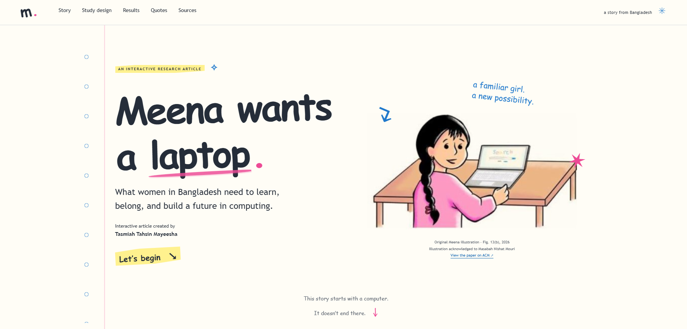

# Meena wants a laptop

*What women in Bangladesh need to learn, belong, and build a future in computing.*

Interactive article created by **Tasmiah Tahsin Mayeesha**.

## Read the article

https://tahsin-mayeesha.github.io/meena-wants-a-laptop/

## About

An interactive synthesis of two research papers on women in computing
in Bangladesh, featuring findings, published participant quotations,
original research figures, and references.

## Research papers

- [The Necessary Ingredients for Success of Women in Computing:
  A 360° Perspective from Students, Professionals and Stakeholders (2025)](https://doi.org/10.1145/3724502)
- [Meena Needs a Computer Now: Co-design Solutions to Barriers
  Using Fictional Inquiry for Women in Computing (2026)](https://doi.org/10.1145/3762808)

## Technology

Static HTML, CSS, and JavaScript. No installation or build step
is required for GitHub Pages.

## Credits

Original research project: **My Freedom in Light**

Research lab: [NSUHCI–DIAL, North South University](https://sites.google.com/view/nsuhci/home)

Research figures and quotations retain their original attribution
and reuse terms. See the article and source papers for full credits.

Research supervision: **Nova Ahmed**
